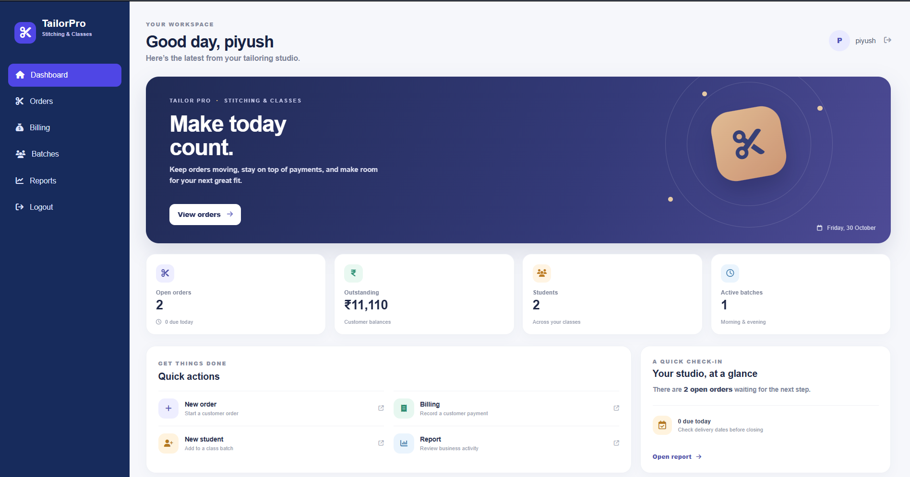
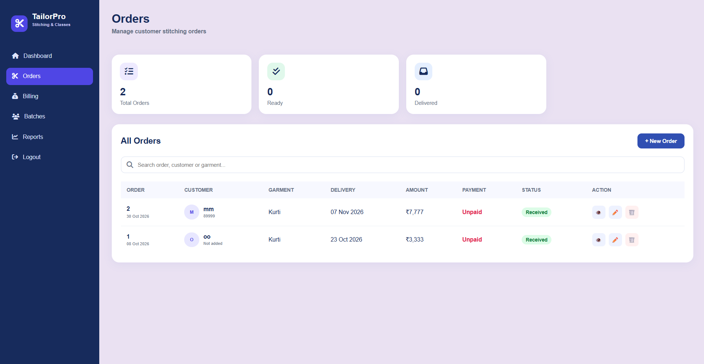
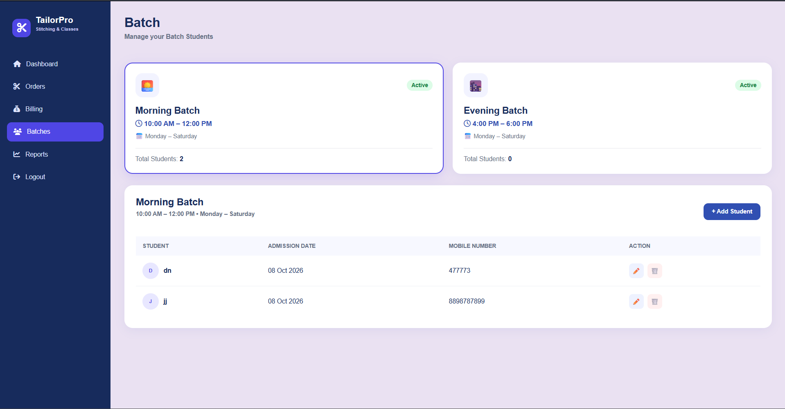
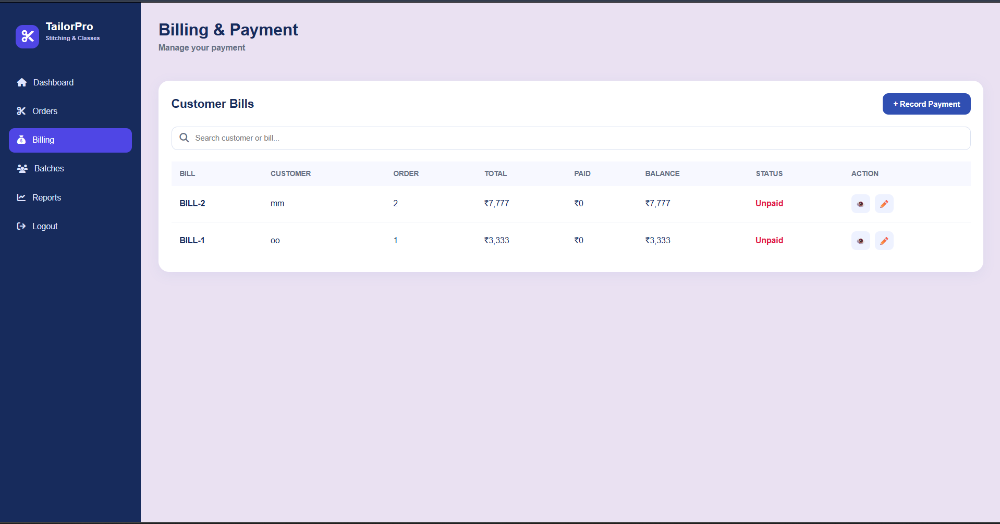

# 🧵 Tailor Pro – Tailor Management System

**Tailor Pro** is a web-based tailor management system developed to simplify and organize the daily operations of a tailoring business. It helps tailor shop owners manage customers, measurements, stitching orders, student batches, billing, and business reports from a single platform.

The application is designed for tailor shop owners who handle both clothing orders and tailoring classes.

## ✨ Features

### 1. Dashboard
- View an overview of business activities.
- Track pending orders and payments.
- Monitor total students and active batches.
- Access frequently used features through Quick Actions.

### 2. Customer Management
- Manage customer information.
- Organize customer records.
- Access customer details for order management.

### 3. Measurement Management
- Maintain customer measurement records.
- Keep measurements organized for stitching requirements.

### 4. Order Management
- Create and manage stitching orders.
- Track order details and delivery dates.
- Monitor order progress and payment status.

### 5. Batch Management
- Manage tailoring class batches.
- Organize morning and evening batches.
- Maintain student information and admission dates.

### 6. Billing & Payment
- Manage customer payments.
- Track paid, partially paid, and pending amounts.
- Maintain billing records.

### 7. Reports & Analysis
- View business-related information.
- Monitor orders, payments, and student activities.

## 📸 Screenshots

### Dashboard


### Login Page


### Order Management


### Batch Management


### Billing & Payment


## 🛠️ Technologies Used

| Technology | Purpose |
|---|---|
| HTML5 | Page structure |
| CSS3 | Styling and responsive design |
| JavaScript | Frontend interactions |
| Python | Backend development |
| Flask | Web framework |
| SQLite | Database |
| Flask-SQLAlchemy | Database management |
| Flask-Login | User authentication |
| Werkzeug | Password hashing |

## 📂 Project Structure

```text
Tailor-Pro/
│
├── app.py
├── database.db
│
├── templates/
│   ├── login.html
│   ├── register.html
│   ├── home.html
│   ├── customer.html
│   ├── measurement.html
│   ├── order.html
│   ├── batch.html
│   ├── billing.html
│   └── reports.html
│
├── static/
│   ├── styles.css
│   ├── script.js
│   └── images/
│
├── requirements.txt
│
└── README.md
```

*Note: Adjust the folder structure above to match your actual repository.*

## ⚙️ Installation and Setup

Follow these steps to run Tailor Pro locally.

### 1. Clone the repository

```bash
git clone https://github.com/piyush06-kg/REPOSITORY-NAME.git
```

### 2. Navigate to the project directory

```bash
cd REPOSITORY-NAME
```

### 3. Create a virtual environment

```bash
python -m venv venv
```

### 4. Activate the virtual environment

**Windows:**

```bash
venv\Scripts\activate
```

### 5. Install dependencies

```bash
pip install -r requirements.txt
```

### 6. Run the application

```bash
python app.py
```

### 7. Open in browser

```text
http://127.0.0.1:5000/
```

## 🎯 Project Objective

The main objective of Tailor Pro is to reduce manual record-keeping and make tailoring business management easier, faster, and more organized.

It brings customer management, stitching orders, student batch management, and billing operations together in one application.

## 🚀 Future Enhancements

- Automated customer notifications.
- Advanced business analytics.
- PDF invoice generation.
- Data backup and export.
- Improved reporting features.

## 👨‍💻 Developer

**Piyush Gupta**

- GitHub: [@piyush06-kg](https://github.com/piyush06-kg)

---

⭐ If you find this project useful, consider giving the repository a star!